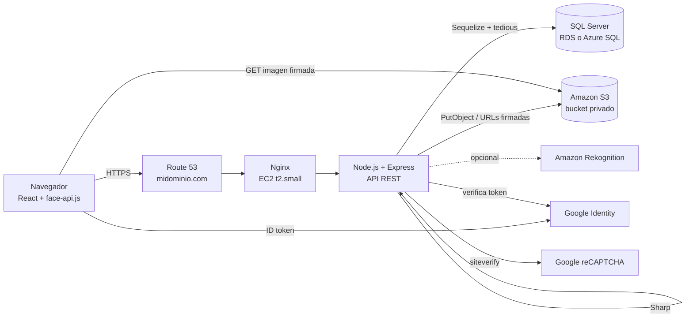
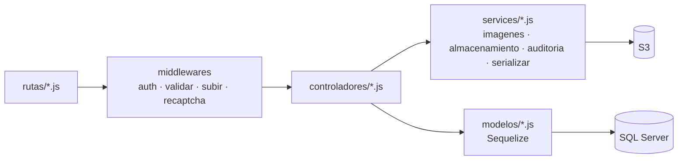
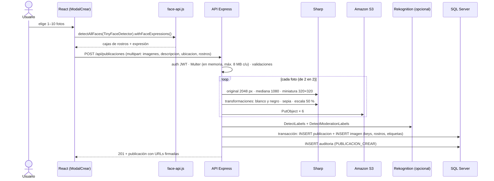
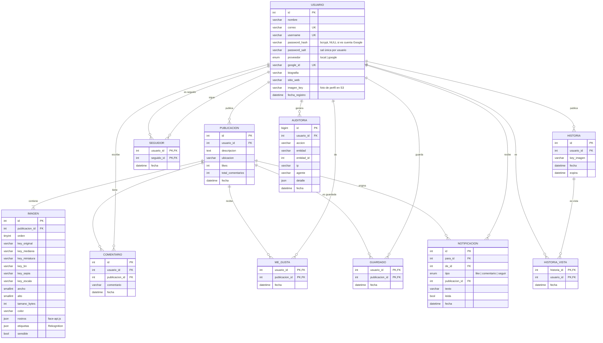

# 01 · Documentación del desarrollador

**Proyecto:** Instagram — red social para almacenar y navegar fotografías
**Curso:** Desarrollo Web · UMG · Catedrático: MSc. Ing. Carlos Alejandro Arias

| Integrante | Carné | Rama en GitHub | Responsabilidad |
|---|---|---|---|
| [Nombre completo] | [Carné] | [rama] | [Backend / Frontend / Nube / Documentación] |
| [Nombre completo] | [Carné] | [rama] | [ ] |
| [Nombre completo] | [Carné] | [rama] | [ ] |

---

## 1. Arquitectura general

La aplicación es una **SPA en React** que consume una **API REST en Express**. Express guarda los datos en
**Microsoft SQL Server** y las fotos en **Amazon S3**. Las imágenes nunca pasan por la base de datos: SQL Server solo guarda
su *key* (ruta dentro del bucket).



| Capa | Tecnología | Carpeta |
|---|---|---|
| Interfaz | React 18, React Router (HashRouter), Vite | `frontend/src` |
| Reconocimiento de rostros | face-api.js (`@vladmandic/face-api`, TinyFaceDetector + expresiones) | `frontend/src/componentes/ModalCrear.jsx`, `frontend/public/modelos-face` |
| API | Express 5, JWT (`jwt-simple`), Multer en memoria, `express-rate-limit` | `rutas/`, `controladores/`, `middlewares/` |
| Procesamiento de imágenes | Sharp | `services/imagenes.js` |
| Almacenamiento | AWS SDK v3 (S3) con URLs firmadas | `services/almacenamiento.js` |
| Base de datos | Microsoft SQL Server 2019+/Azure SQL + Sequelize 6 (driver `tedious`) | `basededatos/`, `modelos/` |
| Autenticación externa | Google Identity Services, reCAPTCHA v2 | `services/google.js`, `services/recaptcha.js` |
| Análisis opcional | Amazon Rekognition | `services/rekognition.js` |

### Patrón del backend

Se conserva la arquitectura del proyecto base: **ruta → middlewares → controlador → modelo**, con la lógica
reutilizable en `services/`.



## 2. Flujo de subida de una foto



Si algo falla después de subir a S3, el controlador borra los archivos ya subidos (no quedan huérfanos)
y la transacción de SQL Server se revierte.

## 3. Algoritmo de almacenamiento y renderización de imágenes

**Almacenamiento**

1. La foto llega a memoria (no se escribe en el disco del servidor).
2. Sharp corrige la orientación EXIF y limita el lado mayor a 2048 px (JPEG mozjpeg, calidad 88).
3. A partir de esa original se generan en paralelo 6 archivos:

| Versión | Tamaño | Formato | Uso |
|---|---|---|---|
| `original.jpg` | hasta 2048 px | JPEG | Vista de resolución completa |
| `mediana.webp` | 1080 px de ancho | WebP | Feed |
| `miniatura.webp` | 320 × 320 (recorte por zona de interés) | WebP | Cuadrículas (Inicio, Explorar, Perfil) |
| `bn.jpg` | igual a la original | JPEG | Transformación 1: blanco y negro |
| `sepia.jpg` | igual a la original | JPEG | Transformación 2: sepia (matriz de color) |
| `escala.jpg` | 50 % de la original | JPEG | Transformación 3: reducción de escala |

4. Las keys siguen la forma `usuarios/{id}/publicaciones/{uuid}/{versión}`. Como cada carpeta lleva un UUID,
   las keys nunca se reutilizan y se pueden cachear como inmutables (`Cache-Control: immutable`).
5. Se calcula el **color dominante** con `sharp.stats()` y se guarda en `imagen.color`.

**Renderización**

- Las cuadrículas cargan solo la miniatura WebP (≈ 10–20 KB) y el feed la mediana: nunca se descarga la
  original salvo al abrir el detalle.
- Mientras una imagen carga se pinta su color dominante, sin saltos de diseño (tamaño reservado con
  `aspect-ratio` y `width/height`).
- `loading="lazy"` y `decoding="async"` en todas las imágenes; el feed y Explorar se paginan
  (10 y 24 elementos) con scroll infinito (`IntersectionObserver`).
- El bucket es privado: la API entrega **URLs firmadas** que duran 1 hora y las reutiliza desde una caché en
  memoria para que el navegador también pueda cachearlas.
- face-api.js (≈ 1.3 MB) se descarga solo al abrir "Crear".

## 4. Esquema de la base de datos

Microsoft SQL Server (2019, 2022, Amazon RDS o Azure SQL Database). Textos en `NVARCHAR` (Unicode: acentos y emojis),
fechas en `DATETIMEOFFSET`, columnas JSON validadas con `ISJSON`. Scripts en
[`basededatos/sqlserver/`](../basededatos/sqlserver/): `01-crear-base.sql`, `02-tablas.sql`, `03-usuarios.sql`
(o `03-usuarios-azure.sql`) y `00-TODO-EN-UNO-local.sql`.



**Reglas de integridad**

- SQL Server no permite que una tabla se borre en cascada por dos caminos distintos. Por eso:
  - Al borrar una **publicación** se borran en cascada sus imágenes, comentarios, me gusta, guardados y
    notificaciones (lo único que la aplicación borra).
  - Al borrar una **historia** se borran en cascada sus vistas.
  - Para borrar un **usuario** completo se usa el procedimiento `dbo.sp_eliminar_usuario`, que borra todo en
    orden dentro de una transacción, recalcula los contadores y devuelve la lista de archivos a borrar de S3.
- `auditoria.usuario_id` queda en `NULL` si se borra el usuario: el historial se conserva.
- Llaves primarias compuestas en `seguidor`, `me_gusta`, `guardado` e `historia_vista` impiden duplicados;
  `CHECK` impide seguirse a uno mismo y valores no válidos en `proveedor` y `tipo`.
- `google_id` es único solo cuando tiene valor (índice único filtrado `WHERE google_id IS NOT NULL`).
- `publicacion.likes` y `publicacion.total_comentarios` son contadores desnormalizados que se actualizan dentro
  de transacciones, para no contar filas en cada carga del feed.
- Vista `dbo.vw_imagenes_por_usuario`: ubicación en S3 de todas las imágenes que posee cada usuario.

## 5. Contraseñas

```js
const salt = await bcrypt.genSalt(12);          // sal única de este usuario
const hash = await bcrypt.hash(password, salt); // hash con esa sal
// se guardan password_salt y password_hash en columnas separadas
```

Al iniciar sesión se recalcula `bcrypt.hash(password, password_salt)` y se compara con
`crypto.timingSafeEqual`. El hash y la sal nunca salen de la API (`defaultScope` del modelo y `toJSON`).
Requisitos: 8–72 caracteres con al menos una letra y un número.

## 6. API REST

Base: `/api`. 🔓 = pública; el resto necesita `Authorization: Bearer <token>` (JWT de 7 días).

| Método | Ruta | Descripción |
|---|---|---|
| GET 🔓 | `/config` | Llaves públicas (Google Client ID, reCAPTCHA site key) |
| POST 🔓 | `/usuarios` | Registro `{ nombre, correo, username, password, recaptcha }` |
| POST 🔓 | `/login` | Login `{ correo o username, password, recaptcha }` |
| POST 🔓 | `/login/google` | Login con Google `{ credential }` |
| GET | `/perfil` | Mis datos |
| GET | `/usuarios?buscar=` | Buscar usuarios (máx. 20) |
| PUT | `/usuarios` | Editar perfil |
| POST / DELETE | `/usuarios/avatar` | Subir (campo `file0`) o quitar foto de perfil |
| GET | `/usuarios/:id` | Perfil público |
| GET | `/usuarios/:id/publicaciones` | Publicaciones de un usuario |
| GET | `/usuarios/:id/contadores` | Publicaciones, seguidores, seguidos, likes, `loSigo`, `meSigue` |
| GET | `/usuarios/:id/seguidores` · `/siguiendo` | Listas |
| GET | `/usuarios/:id/historias` | Historias vigentes |
| GET | `/guardados` | Mis guardados |
| POST | `/publicaciones` | Crear (multipart: `imagenes` ×1–10, `descripcion`, `ubicacion`, `rostros`) |
| GET | `/publicaciones?pagina=` | Explorar (24 por página) |
| GET | `/publicaciones/:id` | Detalle: URLs de original, mediana, miniatura y 3 transformaciones |
| PUT / DELETE | `/publicaciones/:id` | Editar / eliminar (solo el autor) |
| PUT | `/publicaciones/:id/like` · `/guardar` | Alternar me gusta / guardado |
| GET | `/publicaciones/:id/likes` | Personas a las que les gustó |
| POST / GET | `/publicaciones/:id/comentarios` | Comentar / listar |
| DELETE | `/comentarios/:id` | Borrar (autor o dueño de la publicación) |
| POST / DELETE | `/seguidores` · `/seguidores/:id` | Seguir / dejar de seguir |
| GET | `/sugerencias` · `/feed?pagina=` | Sugerencias / feed (10 por página) |
| POST / GET | `/historias` | Subir historia / barra de historias |
| PUT / GET / DELETE | `/historias/:id/vista` · `/historias/:id/vistas` · `/historias/:id` | Marcar vista / quién vio / borrar |
| GET / PUT | `/notificaciones` · `/notificaciones/sin-leer` · `/notificaciones/leidas` | Notificaciones |
| GET 🔓 | `/salud` (fuera de `/api`) | Estado del servidor |

Respuesta de una imagen:

```json
{
  "id": 12, "ancho": 1080, "alto": 1350, "color": "#882818",
  "rostros": [{ "x": 0.31, "y": 0.18, "w": 0.21, "h": 0.2, "puntaje": 0.93, "expresion": "feliz" }],
  "etiquetas": [{ "nombre": "Person", "confianza": 99 }],
  "sensible": false,
  "urls": { "miniatura": "https://...", "mediana": "https://...", "original": "https://..." },
  "transformaciones": { "bn": "https://...", "sepia": "https://...", "escala": "https://..." }
}
```

## 7. Frontend (React)

| Carpeta | Contenido |
|---|---|
| `src/vistas` | `Bienvenida` (login, registro, Google, reCAPTCHA), `Inicio`, `Explorar`, `Perfil` |
| `src/componentes` | `ModalCrear` (face-api.js), `ModalPublicacion` (resolución completa + transformaciones), `VisorHistorias`, `Paneles` (buscar, notificaciones), `Navegacion`, `Publicacion` (carrusel, tarjeta, miniatura) |
| `src/contexto` | `Sesion` (usuario, token, seguidos) e `Interfaz` (avisos, ventanas, paneles) |
| `src/almacen.js` | Almacén compartido: un "me gusta" se refleja en todas las tarjetas a la vez |
| `src/api.js` | Cliente de la API con el token JWT |

Las llaves públicas de Google y reCAPTCHA se leen de `GET /api/config`, así se cambian en el `.env` sin
volver a compilar React.

## 8. Variables de entorno

Ver [`.env.example`](../.env.example). Las más importantes: `DB_MOTOR=mssql`, `DB_HOST`, `DB_PUERTO`/`DB_INSTANCIA`, `DB_USUARIO`, `DB_CLAVE`, `DB_CIFRAR`, `DB_CONFIAR_CERTIFICADO`, `DB_CA_ARCHIVO`, `JWT_SECRETO`, `ALMACENAMIENTO=s3`,
`S3_BUCKET`, `AWS_REGION`, `GOOGLE_CLIENT_ID`, `RECAPTCHA_SITE_KEY`, `RECAPTCHA_SECRET`, `REKOGNITION`.
En la EC2 **no** se ponen llaves de AWS: la instancia usa un rol de IAM.

## 9. Pruebas realizadas

| Prueba | Resultado |
|---|---|
| Batería de 70 pruebas de la API (registro, login, Google, perfil, publicaciones, Sharp, permisos 403, cascadas, historias, notificaciones, guardados, búsqueda) | Todas pasan |
| Consultas que la app envía a SQL Server (feed paginado, búsqueda con `LIKE`, login, inserciones con `OUTPUT`, likes, notificaciones, historias, auditoría): generadas por Sequelize y validadas como T-SQL | 20 de 20 válidas |
| Scripts T-SQL (`basededatos/sqlserver`): tablas, índices, llaves y restricciones validadas con un analizador de T-SQL | Sin errores |
| Usuario de base de datos con mínimo privilegio: `DELETE FROM auditoria` | Rechazado |
| Modo S3 contra un emulador de S3: subida de las 6 versiones, URLs firmadas, descarga y borrado | Todas pasan |
| Transformaciones: miniatura 320×320, escala exactamente 50 %, B&N con canales iguales, sepia con rojo > azul | Correcto |
| face-api.js en el navegador con una foto real (dominio público, NASA) | Detecta 1 rostro y su expresión ("feliz") |
| Login con Google (respuestas de Google simuladas): crear cuenta, vincular por correo, token falso | Correcto |
| reCAPTCHA (respuesta simulada): válido, inválido, ausente | Correcto |
| Interfaz en Chromium a 1366 px y 390 px (celular), sin desbordamiento horizontal | Sin errores de JavaScript |

> La batería de la API se ejecutó con el mismo código usando `DB_MOTOR=mysql`, porque el entorno de desarrollo no
> tenía SQL Server. Antes de entregar, ejecútenla también contra su SQL Server (registro, publicar, comentar,
> seguir, historias).
