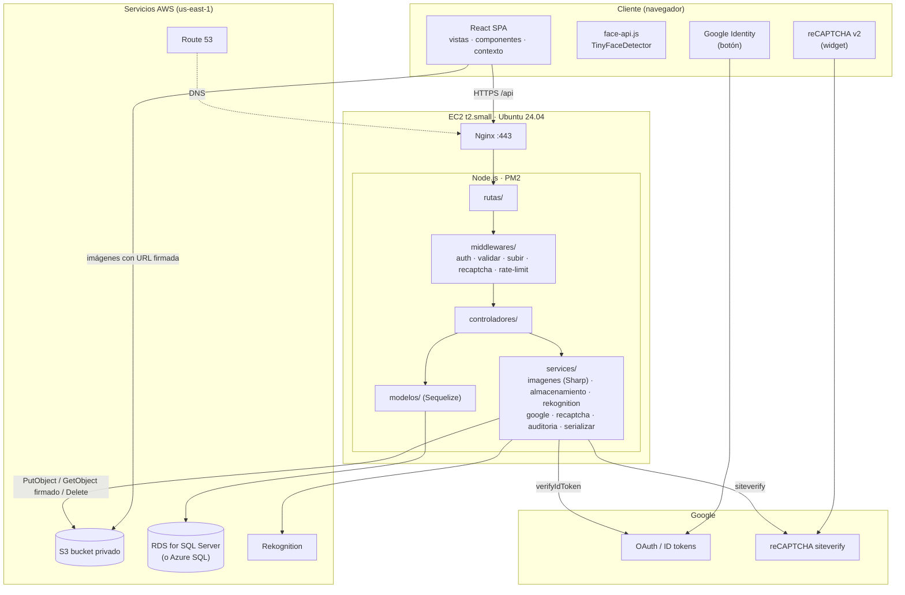
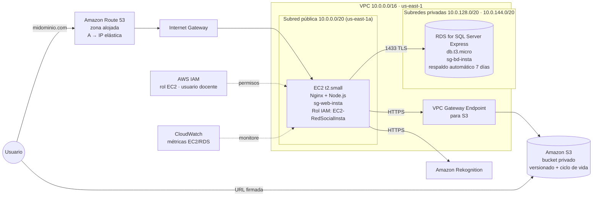

# 04 · Arquitectura de la solución, nube y red

## 1. Arquitectura de la solución

La solución se divide en tres capas: presentación (React en el navegador), aplicación (Express en EC2) y
datos (SQL Server para la información y S3 para las imágenes). Los servicios de Google y AWS se integran por API.

| Capa | Componente | Responsabilidad |
|---|---|---|
| Presentación | React 18 + face-api.js | Interfaz, detección de rostros en el navegador, Google Login y reCAPTCHA |
| Entrada | Route 53 + Nginx (HTTPS, Let's Encrypt) | DNS, TLS, compresión, límite de tamaño de subida, proxy inverso |
| Aplicación | Node.js 20 + Express 5 (PM2) | API REST, JWT, validaciones, Sharp, auditoría |
| Datos | Microsoft SQL Server (Amazon RDS for SQL Server Express o Azure SQL Database) | Usuarios, publicaciones, ubicación de las imágenes, relaciones, auditoría |
| Archivos | Amazon S3 | Original, mediana, miniatura y 3 transformaciones de cada foto; historias; avatares; respaldos |
| Servicios externos | Google Identity, reCAPTCHA, Amazon Rekognition | Autenticación, anti-bots, etiquetas y moderación |

## 2. Diagrama distribuido de componentes

## 3. Diagrama de cloud computing (despliegue en AWS)

**Decisiones**

- **EC2 t2.small (1 vCPU, 2 GB):** suficiente para Express + Sharp; se agrega 2 GB de swap y Sharp procesa las
  fotos de 2 en 2 para no agotar la memoria.
- **S3 privado + URLs firmadas:** ninguna foto es pública por accidente; las URLs vencen en 1 hora.
- **Rol de IAM en la instancia:** no hay llaves de AWS en el código ni en el `.env`.
- **RDS en subred privada:** la base de datos no es accesible desde internet, solo desde la EC2. Los scripts se
  ejecutan desde SSMS por un túnel SSH a través de la EC2.
- **SQL Server Express en RDS** (capa gratuita). No se instala SQL Server dentro de la t2.small porque necesita casi
  toda su memoria (2 GB).
- **Conexión cifrada (TLS)** entre la app y SQL Server, verificando el certificado de Amazon RDS.
- **Alternativa Azure:** Azure SQL Database con firewall que solo admite la IP de la aplicación.
- **Alternativa con AWS Lambda:** las transformaciones podrían moverse a una Lambda disparada por el evento
  `s3:ObjectCreated` del prefijo `originales/`. Se eligió Sharp en la EC2 para mantener un solo despliegue y
  porque la t2.small procesa una foto en ≈ 0.3–0.5 s.

## 4. Segmentación de red

| Segmento | CIDR | Contiene | Acceso desde internet |
|---|---|---|---|
| VPC `insta` | 10.0.0.0/16 | Todo | — |
| Subred pública A (us-east-1a) | 10.0.0.0/20 | EC2 (Nginx + Node) | Sí, solo 80/443 (y 22 desde la IP del equipo) |
| Subred pública B (us-east-1b) | 10.0.16.0/20 | Reserva (otra instancia o balanceador a futuro) | Sí |
| Subred privada A (us-east-1a) | 10.0.128.0/20 | RDS (principal) | No |
| Subred privada B (us-east-1b) | 10.0.144.0/20 | RDS (requerida por el grupo de subredes) | No |

Las subredes privadas no tienen ruta a internet. La EC2 llega a S3 por el **VPC Gateway Endpoint** sin salir a
internet.

**Grupos de seguridad (firewall por instancia)**

| Grupo | Dirección | Puerto | Origen / destino | Motivo |
|---|---|---|---|---|
| `sg-web-insta` | Entrada | 443 | 0.0.0.0/0 | HTTPS |
| `sg-web-insta` | Entrada | 80 | 0.0.0.0/0 | Redirección a HTTPS y validación de Let's Encrypt |
| `sg-web-insta` | Entrada | 22 | IP del equipo /32 | Administración por SSH |
| `sg-web-insta` | Salida | 443 | 0.0.0.0/0 | S3, Rekognition, Google |
| `sg-web-insta` | Salida | 1433 | `sg-bd-insta` | SQL Server |
| `sg-bd-insta` | Entrada | 1433 | `sg-web-insta` | Solo la aplicación llega a la base |

Dentro de la EC2, Node escucha solo en el puerto 3000 y Nginx es el único que lo expone.

## 5. Aplicación web — capas de seguridad

| Amenaza | Control |
|---|---|
| Robo de contraseñas | bcrypt 12 rondas + sal única; comparación en tiempo constante |
| Fuerza bruta | `express-rate-limit`: 20 intentos / 15 min por IP en login y registro; reCAPTCHA |
| Bots en registro | reCAPTCHA v2 verificado en el servidor |
| Suplantación con Google | El ID token se verifica con la llave pública de Google y la audiencia `GOOGLE_CLIENT_ID` |
| Acceso sin sesión | JWT firmado (7 días) en todas las rutas protegidas |
| Modificar datos ajenos | Cada controlador verifica que el usuario del token sea el dueño (403) |
| Inyección SQL | Consultas parametrizadas de Sequelize; búsqueda `LIKE` con comodines escapados |
| XSS | React escapa todo el texto; no se usa `dangerouslySetInnerHTML` |
| Archivos maliciosos | Solo tipos de imagen, 8 MB máx., 10 por publicación; Sharp re-codifica toda imagen |
| Exposición de datos | Correo, hash y sal nunca salen en perfiles ajenos |
| Contenido inapropiado | Rekognition marca la foto como sensible y se muestra borrosa |
